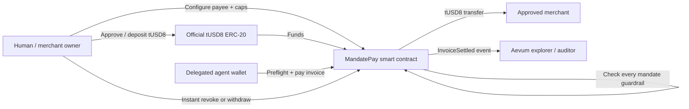

# MandatePay

**Give agents a budget. Not a blank check.**

 -45d7a6) 

MandatePay is an open-source, self-custodial prototype for **stablecoin payments initiated by agents under human-defined on-chain limits**. Built **November 18, 2026** for [Aevum Builder Challenge #1](https://dorahacks.io/hackathon/qday/detail), using QDay's official Aevum testnet and already-deployed tUSD8 token.

**Status (18 Nov 2026):** [Public source](https://github.com/samertall/tools/tree/mandatepay-aevum-2026) published on a dedicated branch; [GitHub CI](https://github.com/samertall/tools/actions/runs/44312392695) passed Solidity compilation and automated tests; [responsive frontend](https://mandatepay-aevum.vercel.app) deployed. **Aevum contract deployment, on-chain settlement evidence, explorer source verification, and DoraHacks submission are NOT complete.** Do not claim production readiness or testnet deployment without evidence. [Final steps](docs/FINAL-STEPS.md).

## Problem and differentiated approach

Autonomous agents can already request payment, but relying on natural-language instructions ("don't spend too much") is not a security boundary. MandatePay turns each human authorization into an enforceable, revocable contract policy. The operating model is deliberately narrow: **one owner, one active agent mandate, an explicit merchant allowlist, bounded spend, unique invoice IDs**, and observable tUSD8 settlements.

It is useful for API purchasing, outsourced compute, subscription fulfillment, automated merchant payouts, and invoice settlement. A service provider gets a real on-chain receipt, while the owner can revoke access without changing keys or asking the agent to stop.

## What it does

- Owner deposits official **6-decimal test tUSD8** using `approve` + `deposit`.
- Owner permits/revokes particular merchant addresses.
- Owner creates a **time-limited, scoped mandate** for a dedicated agent EOA.
- Agent checks the policy (`checkPayment`) before attempting to settle a unique invoice.
- Contract checks authorized agent, expiry, approved merchant, max single payment, UTC-day cap, lifetime budget, vault balance and invoice replay.
- Contract transfers actual tUSD8 to approved merchant, updates owner vault accounting, and emits `InvoiceSettled` with agent + invoice proof.
- Owner can revoke instantly and withdraw unspent funds. No back-end ever receives a private key.

**Design choice:** scoped, delegated EOAs rather than claiming this proof-of-concept integrates QDay's ERC-4337 bundler or ERC-8004 identity registry. Those are follow-on integrations until endpoints and deployed addresses are independently verified.

## Architecture



### Real network constants

| Setting | Value |
|---|---|
| Network | QDay Aevum Testnet |
| Chain ID | `44005` (`0xABE5`) |
| RPC | `https://rpc-test.qday.info` |
| Explorer | `https://explorer-test.qday.info` |
| Faucet | `https://faucet.qday.info/en` |
| Native test gas | `tQDAY`, 18 decimals |
| Official ERC-20 | `tUSD8`, 6 decimals |
| Token contract | `0x456569838f1d43009A91ebA4263147Afd7233483` |
| MandatePay contract | **Not deployed / supply address** |

Source: https://qday.io/official-links and https://qday.io/build (last checked 2026-11-18).

## Quick start

Requires Node.js 20+ and an EIP-1193 browser wallet such as MetaMask. All usage is on testnet; do not use real money or an important mainnet wallet.

```bash
npm install
npm run compile
npm test
```

### Deploy on Aevum

1. Add the [official Aevum chain](https://qday.io/build) to your wallet, obtain **tQDAY gas** and **tUSD8** from the [official faucet](https://faucet.qday.info/en). Use a fresh disposable wallet.
2. Copy `.env.example` to `.env` and set `DEPLOYER_PRIVATE_KEY` **only locally**. This value is for Hardhat's deployer and must never go into the web app, repository, screenshots or chat.
3. Compile and deploy:

```bash
npm run compile
npm run deploy:aevum
```

4. The script rejects a wrong chain or a nonexistent tUSD8 contract and writes `web/deployment.json` locally with the contract address and deploy transaction. Put that deployed address into `web/config.js` (`contractAddress`) for a default web configuration, or paste it into the live UI. For a public static hosting deploy, manually commit the **address only**, never wallet secrets.
5. Inspect the explorer transaction and independently verify the exact source and compiler settings on the QDay explorer if supported. Keep links to verified source and transaction receipts in your DoraHacks entry. Source-code publication in GitHub is **not** equivalent to explorer verification.

### Run the UI

```bash
npm run serve
```

Open `http://localhost:4173`. The UI is a responsive, no-build static app. It imports the official Ethers v6 browser bundle from jsDelivr, so the browser needs internet. Host the `/web` folder on Vercel, Netlify, or any static server (`web/vercel.json` supplied).

### Reproduce a full end-to-end demo

Use **three separate disposable test wallets**: Owner, Agent, Merchant.

1. Owner connects MetaMask on chain `44005`, pastes the deployed contract address, and sees it **validated against official tUSD8**.
2. Owner gets faucet tUSD8, approves and deposits `25.000000` into MandatePay. Confirm the deposit on the explorer.
3. Owner allowlists Merchant address.
4. Owner creates a mandate for Agent: **max 5 tUSD8/payment**, **daily 15 tUSD8**, **total 25 tUSD8**, **expires after 24 hours**.
5. Agent switches wallet account and reconnects. Enter Owner address, Merchant address, amount `3`, invoice `INV-001`.
6. Click **Check policy**. A result of `0` means the current state permits this exact payment.
7. Click **Execute payment** and sign with Agent. Observe `InvoiceSettled` and the merchant's actual tUSD8 balance increase.
8. Try `INV-001` again and observe code **10** (replay). Try `6` tUSD8 and observe code **6** (per-payment cap).
9. Switch to Owner; click **Revoke agent immediately**. Switch back to Agent and check a new invoice: code **1** (no active mandate).
10. Owner withdraws unused tUSD8. Show explorer links and validated state for the judges.

Each transaction will cost a small amount of **test tQDAY** gas and requires normal wallet approval. The preflight query does not reserve capacity; transactions can become invalid before inclusion. Contract enforcement is authoritative.

## Contract API

| Function | Who may call | Description |
|---|---|---|
| `deposit(uint256 amount)` | Owner | Pull exact tUSD8 after ERC-20 approval |
| `withdraw(uint256 amount)` | Owner | Recover **only that owner's** unspent vault balance |
| `setPayee(address payee,bool approved)` | Owner | Add/remove a merchant |
| `setMandate(agent,maxPerPayment,dailyLimit,totalBudget,expiresAt)` | Owner | Replace mandate with new scope, reset counters |
| `revokeMandate()` | Owner | Immediately disable agent permission |
| `checkPayment(owner,agent,payee,amount,invoiceId)` | Anyone | Read-only reason code (`0` = eligible) |
| `pay(owner,payee,amount,invoiceId)` | Authorized agent | Validate policy then transfer tUSD8 to payee |
| `vaultBalances(owner)` | Anyone | Read owner vault balance |
| `mandates(owner)` | Anyone | Read active agent and limits |
| `paidInvoices(owner,invoiceId)` | Anyone | Read invoice deduplication state |

`amount` values are **uint256 base units** (`1 tUSD8 = 1_000_000`); `expiresAt` is Unix epoch seconds; `invoiceId` is `keccak256(utf8(reference))`. All amounts are exact integers; no float math in the contract. Invoice references are visible if voluntarily disclosed off-chain. Do not use confidential invoice titles.

### `checkPayment` return codes

`0` eligible; `1` inactive; `2` wrong agent; `3` expired; `4` payee not approved; `5` invalid amount/invoice; `6` per-tx cap; `7` daily cap; `8` total budget; `9` insufficient vault balance; `10` invoice already paid. Daily cap resets at **00:00 UTC** (block timestamp / 86400).

## Safety, trust and constraints

- Contract **only** accepts the official tUSD8 address at deployment; the deploy script checks on-chain code and chain ID.
- Testnet contract does not request a seed phrase or private key in the UI. Only your browser wallet signs transactions.
- Checks + state writes happen inside a `nonReentrant` function before any ERC-20 transfer; ERC-20 calls check success and token return value.
- Owner-specific vault accounting isolates users; each invoice ID is one-time **per owner**.
- The owner may replace a mandate. This deliberately resets usage counters and is an explicit owner action; spent funds are never restored.
- An agent can still spend up to its remaining approved budget until revoked. Revoke immediately if an agent key is compromised.
- The project does not implement compliance screening, multisig, recovery, ERC-4337 smart accounts, ERC-8004 identities, or a production-grade audit. Treat all present implementations as **hackathon-only prototypes**.
- Third-party dependency versions are pinned. Security, dependency, and smart-contract audits are required for production.
- This product does **not** implement post-quantum signing cryptography. It uses QDay's EVM-compatible testnet as the settlement chain, with a roadmap toward PQ infrastructure.

## Tests and reproducibility

`test/MandatePay.cjs` exercises escrow isolation, payment settlement, unique invoice enforcement, wrong signer, unapproved payee, per-payment limits, daily budget, lifetime caps, expiry, revocation, invalid inputs and insufficient vault balance. GitHub Actions runs syntax check + Solidity compile + test suite on pushes and PRs. **Test results must not be claimed as passing until CI or local tooling actually runs them.**

## Deployment / submission evidence checklist

- [x] Public MIT-licensed source branch published in an existing public GitHub repository
- [x] `npm test` passes with green GitHub Actions CI
- [ ] Aevum deployment confirmed (`44005`)
- [ ] Contract source verified on explorer
- [ ] Web UI hosted and checked with real wallet
- [ ] Deposit and merchant allowlist transactions captured
- [ ] Agent payment transaction captured
- [ ] Double-pay/over-cap/revocation demonstrated
- [ ] 3–5-minute live finalist presentation rehearsed
- [ ] DoraHacks entry submitted before **2026-12-11 08:00 UTC** (**11:00 Amman time**)

## Business opportunity

Start as a developer-friendly SDK and policy dashboard for agent-to-merchant payments, API metering, B2B procurement bots and service settlement. Open-source vault core; commercial hosted monitoring, hosted compliance integrations, multi-approver policies and enterprise audit connectors could be paid layers. Go-to-market: publish the repository and starter templates, partner with API sellers and QDay ecosystem dApps, then pilot controlled agent procurement workflows. This is a **hypothesis**, not a proven revenue or user-demand claim.

## Roadmap

1. MVP: single-agent mandate, invoice replay prevention, direct tUSD8 settlement (**this repository**).
2. Harden: multiple concurrent mandates, rate limits, signed merchant invoices, event indexer, optional dual approvals, formal invariant tests.
3. Integrate QDay official smart accounts / session-key SDK and ERC-8004 **after verifying public interface and deployed endpoints**.
4. Prepare mainnet deployment only after review, audit, operational reliability and regulatory analysis.

## Open source / credits

Copyright © 2026 Samer Tallauze. MIT licensed.

Third-party runtime: [ethers.js](https://github.com/ethers-io/ethers.js) (MIT). Development: [Hardhat](https://github.com/NomicFoundation/hardhat) (MIT), [Hardhat Ethers](https://github.com/NomicFoundation/hardhat/tree/main/packages/hardhat-ethers) (MIT), [Hardhat Chai Matchers](https://github.com/NomicFoundation/hardhat/tree/main/packages/hardhat-chai-matchers) (MIT), [Chai](https://www.chaijs.com/) (MIT), [dotenv](https://github.com/motdotla/dotenv) (BSD-2-Clause) and [serve](https://github.com/vercel/serve) (MIT). Google Fonts (DM Sans/Manrope) use SIL Open Font License. No pre-existing copyrighted code was copied into the project.
