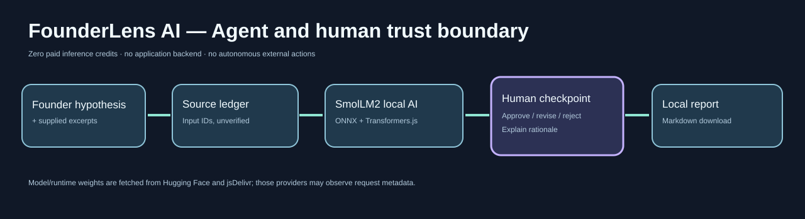

# FounderLens AI — Evidence before decisions

A browser-based, source-bound research co-pilot that helps early-stage founders challenge assumptions using an **open-weight, no-cost AI model**, with a **mandatory human judgment checkpoint** before a report can be downloaded.

> Status (Nov 16, 2026): live deployment verified, all seven unit tests and the Chromium browser E2E test passed with a real SmolLM2 inference and mandatory approval/export gate ([test run](https://github.com/samertall/tools/actions/runs/43857140743)). **Observed generation: 18.1 seconds** for this synthetic CI case, including initial load. Source attribution quality was poor in this run: the small model repeated and misattributed excerpts; critique remains unverified and editable. No paired manual-versus-assisted study has established time savings. [Earlier concept video](https://youtu.be/Y-k95RwgRkc) is not a real agent demo.

**Live test application:** https://founderlens-ai-hetic-2026.vercel.app\n\n**Recorded verification:** [GitHub Actions: real-model end-to-end test and downloadable video artifact](https://github.com/samertall/tools/actions/runs/43857140743)\n\n## Why this matters

Founders often mistake plausible market observations for validated demand. FounderLens converts user-supplied evidence into structured counter-arguments and discovery questions so they can decide what to investigate. The product does **not** assert that sources were visited or verified, and does not contact customers or submit anything externally.

## Workflow

1. **Input:** Describe a falsifiable founder assumption, customer segment, and excerpts from up to four sources or interview notes.
2. **Source organization:** Label notes `[S1]`–`[S4]` and create a source ledger. This step is deterministic.
3. **AI critique:** Download and run the open-weight SmolLM2-135M-Instruct ONNX model in the browser. Ask for risks, missing evidence, and low-cost discovery questions using only supplied notes. First run downloads approximately 137 MB of model weights and tokenizer assets; processing speed depends on the device.
4. **Human judgment:** Founder edits the critique and explicitly **approves**, **approves with reservations**, or **rejects** it. They must write their reasoning and acknowledge the limitations.
5. **Report:** Only after the human checkpoint, generate a local Markdown report preserving the sources, critique, decision, and honest time measurements.

## Run and test locally

No paid keys or subscriptions needed. Chrome/Edge/Firefox with WebAssembly and a modern desktop recommended. Model download requires an internet connection the first time.

```bash
cd founderlens-ai
python3 -m http.server 8080
# open http://localhost:8080
```

Automated tests (Node 20+):

```bash
node --test
```

1. Load **Synthetic example**.
2. Click **Generate AI critique**. Allow time for the ONNX model download and CPU generation.
3. Inspect and edit its output; read the evidence ledger.
4. Select a review outcome; write the rationale and check the evidence acknowledgement.
5. Download the report. Test that export is disabled until all human actions are completed.

## Deployment

This is a **static website**. Set the project root to `founderlens-ai/` in Vercel and deploy without a build command; alternatively host its files on any static HTTPS host. No environment variables or API keys are required. Browser downloads JavaScript dependencies from jsDelivr and open weights from Hugging Face; provider availability and policies may change.

## Architecture



See [docs/architecture.md](docs/architecture.md) for the exact data flow and controls.

## Documentation

- [AI disclosure](docs/ai-disclosure.md)
- [Time-saved methodology](docs/time-saved.md)
- [Human judgment design](docs/human-judgment.md)
- [Responsible AI](docs/responsible-ai.md)

## Technical stack (implemented)

Vanilla HTML, CSS, JavaScript ES modules; `@huggingface/transformers` 3.8.1 loaded from jsDelivr; ONNX Runtime Web; [onnx-community/SmolLM2-135M-Instruct-ONNX-MHA](https://huggingface.co/onnx-community/SmolLM2-135M-Instruct-ONNX-MHA) (quantized q8, WebAssembly CPU); static hosting; Node built-in test runner. No paid inference credits, server storage, scraping, or email integrations.

## Scope and limitations

- AI model does **not** browse the web or verify URLs. Evidence is user-supplied.
- A small 135M model can hallucinate or misunderstand excerpts; treat output as prompts for critical inquiry, not facts.
- Input data and report generation run on-device; weights and library code are fetched from external hosting. Avoid sensitive data.
- Quantified saving from a real paired manual-vs-assisted study is **not yet established**. The app records session durations to support later comparisons.
- Live-model browser inference and video evidence still require final hands-on checks before hackathon submission.

## Authorship disclosure

Product concept proposed by Samer Tallauze. Source code, wording, interface and documentation were drafted with assistance from OpenAI's ChatGPT GPT-6 on November 16, 2026. Human contributors must review, test, and accept the final project and model disclosures before submission.