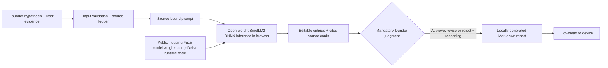

# FounderLens AI — architecture and controls

**Trust boundaries:** No application backend. Data stays in browser memory. The app downloads public model weights and runtime libraries from third-party CDNs, which may log request metadata. Founder-provided excerpts are unverified. Generated critique is editable and separated from the source ledger.

**Human gate:** An AI critique must exist, an explicit approve/revise/reject decision must be selected, substantive reasoning must be written, and a source-limit acknowledgement must be checked. No external business action is possible.

**Failure handling:** Missing assumptions or notes block generation; model network/inference errors are shown directly rather than replaced with invented output. An AI generation error leaves export disabled.
